# Podsjetnik

## Od scene do datoteke

- Kako svjetlost postaje matrica brojeva:

\begin{center}
\small
objektiv → CFA → senzor → \textbf{sirovi podaci} → demozaikiranje → balans bijele → gama → \textbf{zapis u datoteku}
\end{center}

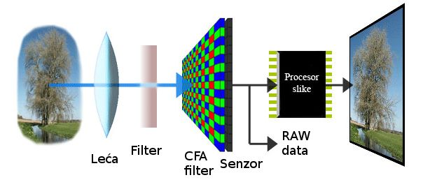{width=62%}

## Matrični zapis digitalne slike

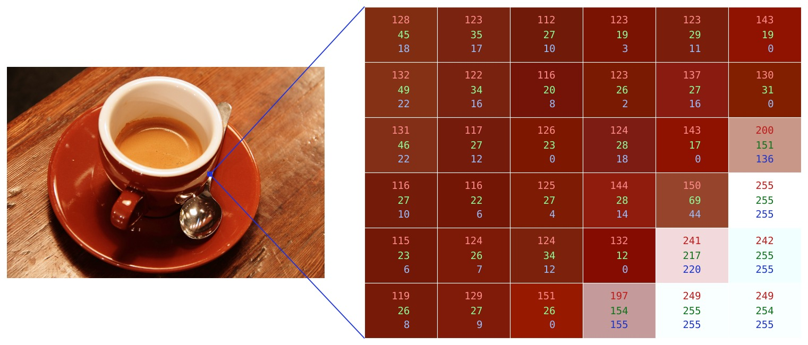{width=64%}

- **dimenzije**, **dubina** (bita po komponenti, najčešće 8) i **prostor boja** (RGB, sive razine, CMYK)

\begin{deklaracija}
Datoteka mora sadržavati i vrijednosti piksela i podatke bez kojih se one ne mogu protumačiti.
\end{deklaracija}

## Koliko je to podataka?

- Slika $600 \times 400$ u boji, 8 bita po komponenti:

$$600 \times 400 \times 3 = 720\,000 \text{ bajtova} \approx 703 \text{ kB}$$

- Fotografija iz 24 Mpx aparata: $6000 \times 4000 \times 3 \approx 69$ MB
- Isti aparat u 14-bitnom RAW zapisu: $6000 \times 4000 \times 14$ bita $\approx 40$ MB

\vspace{1ex}

- Memorijska kartica od 64 GB primila bi oko 900 takvih nekomprimiranih fotografija
- **Sažimanje nije opcija nego nužnost**

# Slikovna datoteka

## Što datoteka sadrži

```{=latex}
\begin{columns}[T]
\begin{column}{0.50\textwidth}
```

- Raspored i naziv dijelova ovise o formatu, ali sadržaj je uvijek sličan
- Bez zaglavlja niz bajtova nema značenje: isti podaci mogu biti slika $600 \times 400$ ili $400 \times 600$

```{=latex}
\end{column}
\begin{column}{0.48\textwidth}
\vspace{-1.06cm}
\centering
\includegraphics[height=0.95\textheight]{slike/p03_struktura_datoteke.png}
\end{column}
\end{columns}
```

## Potpis datoteke

Prvih nekoliko bajtova identificira format (*magic number*):

```
BMP    42 4D                          BM
PNG    89 50 4E 47 0D 0A 1A 0A        .PNG....
JPEG   FF D8 FF E0 ... 4A 46 49 46    ......JFIF
GIF    47 49 46 38 37 61              GIF87a
TIFF   49 49 2A 00                    II*.        (little-endian)
       4D 4D 00 2A                    MM.*        (big-endian)
WebP   52 49 46 46 .... 57 45 42 50   RIFF....WEBP
```

- Ekstenzija je samo dio imena --- **format se prepoznaje po sadržaju**
- Preimenovanje `slika.png` u `slika.jpg` ne mijenja ništa u datoteci

## Zašto je to forenzički važno

- Ekstenzija koja ne odgovara sadržaju --- trag da je datoteka preimenovana ili prerađena
- Sadržaj skriven pod krivom ekstenzijom
- Podaci nadodani **iza** kraja slike (slika se prikazuje normalno)

\vspace{1ex}

\begin{deklaracija}
Prvo pitanje u analizi datoteke nije „što se vidi na slici“, nego „je li ovo doista datoteka onog formata koji ime obećava“.
\end{deklaracija}

## Redoslijed bajtova

- Vrijednosti veće od jednog bajta mogu se zapisati na dva načina:
    - **little-endian** --- najmanje značajan bajt prvi (Intel)
    - **big-endian** --- najznačajniji bajt prvi (Motorola, mrežni poredak)
- Broj $90 = 0\text{x}0000005A$ zapisuje se kao:

```
little-endian:   5A 00 00 00
big-endian:      00 00 00 5A
```

- TIFF (a time i EXIF) podržava **oba**, pa prva dva bajta kazuju koji je u uporabi
- Pogrešna pretpostavka o poretku daje besmislene vrijednosti pri čitanju

## Formati zapisa digitalne slike

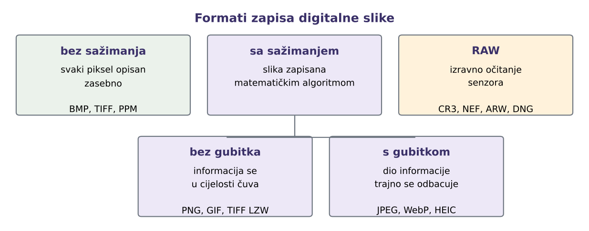{width=94%}


## Što je RAW

- **Izravno očitanje senzora**, bez obrade i bez sažimanja s gubitkom
- Još uvijek **CFA mozaik** --- jedna vrijednost po pikselu, ne tri
- Dubina 12--16 bita po pikselu, linearni odziv
- Uz podatke senzora zapisuju se postavke snimanja i puni metapodaci
- Datoteka nije spremna za prikaz --- fotografiju treba **razviti**

\vspace{1ex}

\begin{deklaracija}
Često se naziva \textbf{digitalnim negativom}, po analogiji s klasičnom fotografijom.
\end{deklaracija}

## Razvijanje

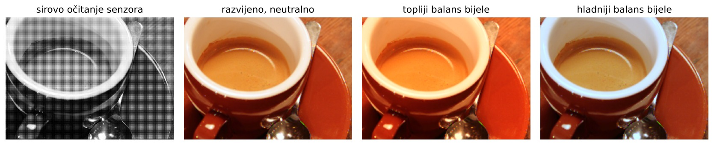{width=100%}

- Iste odluke --- balans bijele, ekspozicija, kontrast, zasićenje, izoštravanje, uklanjanje šuma --- donose se:
    - **u kameri**, automatski, pri spremanju JPEG-a, ili
    - **na računalu**, gdje ih ručno bira onaj tko razvija
- Isti RAW može dati vrlo različite fotografije --- bez ikakve izmjene izvornih podataka

## Formati i ograničenja

- Format ovisi o proizvođaču i često o modelu:
    - **CR2, CR3** (Canon), **NEF** (Nikon), **ARW** (Sony), **RAF** (Fuji), **ORF** (Olympus)
- **DNG** (Adobe) --- pokušaj otvorenog standarda
- Datoteke su velike, a podrška starijih programa neujednačena

\vspace{1ex}

\begin{deklaracija}
RAW je najbliži onome što je senzor zabilježio, ali ni on sam po sebi ne dokazuje autentičnost: i RAW datoteka može se izmijeniti ili generirati.
\end{deklaracija}

## Kontroverze oko RAW formata

Dvije suprotne odluke iz istog mjeseca --- **studenoga 2015.**

:::::: columns
::: {.column width="48%"}
```{=latex}
\small
```

**World Press Photo** --- *traži RAW*

- Najugledniji natječaj novinske fotografije (Amsterdam, od 1955.)
- Uži izbor: autori dostavljaju RAW ili neobrađeni JPEG iz kamere
- uz niz od sedam snimaka: tri prije, prijavljena, tri poslije
- dva analitičara uspoređuju izvornik s prijavom
- Povod: te godine odbačeno oko 20 % takvih fotografija
:::
::: {.column width="48%"}
```{=latex}
\small
```

**Reuters** --- *zabranjuje RAW*

- Ne primaju se fotografije razvijene iz RAW-a
- Traži se JPEG izravno iz kamere; dopušteno je samo izrezivanje kadra i blaga korekcija tonova
- Razlozi: brzina isporuke i načelo da slika mora odražavati stvarnost
:::
::::::

\begin{deklaracija}
Za \textbf{provjeru} je koristan izvornik, a za \textbf{brzu isporuku} datoteka koju je obradila kamera.
\end{deklaracija}

## Kontroverze oko RAW formata

- Prigovori Reutersovoj odluci:
    - JPEG iz kamere **već je obrađen** --- samo su odluke donesene u uređaju, a ne na računalu
    - i JPEG se može neprimjetno izmijeniti; provjera traži forenzičku analizu
    - RAW je teže izmijeniti, a da to ne ostavi trag --- pa je za utvrđivanje autentičnosti **koristniji**
- Pravila World Press Photo vrijede i danas, u istom obliku
- Reuters svoju odluku nije javno povukao

\vspace{1ex}

\begin{deklaracija}
Format sam po sebi ne jamči vjerodostojnost. Ono što pomaže je \textbf{usporedba} s izvornom datotekom i s okolnim snimkama.
\end{deklaracija}

## Zašto je RAW teže izmijeniti?

Izmjena mora biti dosljedna na nekoliko razina odjednom:

- **CFA mozaik** --- RAW nije slika u boji; umetnuti sadržaj mora poštovati raspored filtara, inače ga demozaikiranje pretvori u lažne boje
- **Linearni odziv** --- 12--16 bita, bez gama kodiranja; umetnuti dio mora imati fizikalno ispravan odnos svjetline
- **Šum senzora** --- sirov, bez uklanjanja šuma i sažimanja; otisak senzora osjetljiv je i na male zahvate
- **Alati** --- većina programa RAW samo čita; pisanje traži poznavanje vlasničkog formata pojedinog modela

\vspace{0.5ex}

\begin{deklaracija}
Teže --- ali ne i nemoguće: formati su reverznim inženjerstvom razjašnjeni (\texttt{dcraw}, LibRaw), DNG je otvoren, a kriptografski potpisi u kameri probijeni su 2010. (Canon) i 2011. (Nikon), izvlačenjem privatnog ključa iz samog uređaja.
\end{deklaracija}

# Formati bez sažimanja

## BMP --- mapa bitova

- Vrijednosti piksela zapisuju se u izvornom obliku, bez ikakve obrade
- Struktura: `BITMAPFILEHEADER` (14 B) + `BITMAPINFOHEADER` (40 B) + polje piksela
- Tri osobine koje iznenade pri prvom čitanju:
    - komponente se zapisuju redom **B, G, R**
    - retci idu **odozdo prema gore**
    - svaki redak dopunjava se nulama do višekratnika **4 bajta**

\vspace{1ex}

\begin{deklaracija}
Veličina datoteke: $54 + \text{visina} \times \lceil 3 \cdot \text{širina} / 4 \rceil \cdot 4$ bajtova.
\end{deklaracija}

## BMP --- primjer

```{=latex}
\begin{tikzpicture}[remember picture, overlay]
  \node[anchor=north east] at ($(current page.north east)+(-0.75cm,-0.25cm)$)
    {\includegraphics[height=1.9cm]{slike/p03_bmp_slicica.png}};
\end{tikzpicture}
```

```{=latex}
\vspace{-0.45cm}
```

Slika $3 \times 2$ piksela, datoteka ima **78 bajtova**:

```{=latex}
\vspace{0.4ex}
\hspace*{-0.35cm}\includegraphics[width=0.72\textwidth]{slike/p03_bmp_hex.png}
\vspace{0.6ex}
```

- Iz zaglavlja: `42 4D` = `BM`, veličina 78 B, odmak 54, širina 3, visina 2, 24 bita
- Tri bajta po pikselu (**B, G, R**); točkasto su označeni bajtovi dopune

## BMP --- čitanje piksela

Redak zauzima $3 \times 3 = 9$ B podataka, dopunjeno do 12 B:

\begin{center}
\setlength{\tabcolsep}{5pt}\renewcommand{\arraystretch}{1.15}
\begin{tabular}{r c c c c}
\small redak zapisan prvi:
 & \colorbox[RGB]{0,255,0}{\texttt{00 FF 00}}
 & \colorbox[RGB]{0,0,0}{\textcolor{white}{\texttt{00 00 00}}}
 & \colorbox[RGB]{255,255,0}{\texttt{00 FF FF}}
 & \fcolorbox[RGB]{150,150,150}{247,247,247}{\textcolor{fesbSiva}{\texttt{00 00 00}}} \\
 & {\scriptsize zelena} & {\scriptsize crna} & {\scriptsize žuta} & {\scriptsize dopuna} \\[1.2ex]
\small redak zapisan drugi:
 & \colorbox[RGB]{255,0,0}{\textcolor{white}{\texttt{00 00 FF}}}
 & \fcolorbox[RGB]{150,150,150}{255,255,255}{\texttt{FF FF FF}}
 & \colorbox[RGB]{0,0,255}{\textcolor{white}{\texttt{FF 00 00}}}
 & \fcolorbox[RGB]{150,150,150}{247,247,247}{\textcolor{fesbSiva}{\texttt{00 00 00}}} \\
 & {\scriptsize crvena} & {\scriptsize bijela} & {\scriptsize plava} & {\scriptsize dopuna} \\
\end{tabular}
\end{center}

- Prvi zapisani redak je **donji** redak slike
- `00 00 FF` je crvena, a ne plava --- poredak je B, G, R

## Prednosti i nedostaci

:::::: columns
::: {.column width="49%"}
**Prednosti**

- Krajnje jednostavan zapis, izravno prati matricu piksela
- Čitanje i pisanje bez biblioteka
- Nema gubitka informacije
:::
::: {.column width="49%"}
**Nedostaci**

- Velike datoteke, spor prijenos
- Ograničen na RGB
- Ne podržava prozirnost ni metapodatke
:::
::::::

\vspace{1ex}

- Srodni formati: **PPM/PGM/PBM** --- još jednostavniji, s tekstualnim zaglavljem
- U praksi se koriste za crteže i međurezultate obrade, rijetko za fotografije

# Osnove sažimanja

## Tri vrste redundancije

- **Prostorna** --- susjedni pikseli su slični; vrijednost se može predvidjeti iz okoline
- **Kodna** --- sve vrijednosti nisu jednako česte; čestima se može dati kraći kôd
- **Psihovizualna** --- dio informacije oko slabo opaža, pa se može odbaciti

\vspace{1ex}

\begin{deklaracija}
Sažimanje \textbf{bez gubitka} uklanja samo prvu i drugu vrstu. Sažimanje \textbf{s gubitkom} dira i treću --- i zato je nepovratno.
\end{deklaracija}

## RLE --- kodiranje duljine niza

Niz uzastopnih jednakih vrijednosti zamjenjuje se parom: **koliko puta** i **koja vrijednost**.

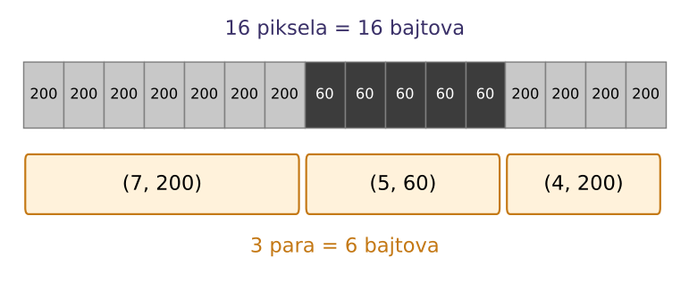{width=56%}

- Učinkovit na jednolikim površinama; na fotografiji su susjedni pikseli rijetko posve jednaki, pa datoteku zna i povećati
- **Koristi se:** BMP (RLE4, RLE8), TIFF (PackBits), faksimil; u JPEG-u za nizove nula

## Huffmanovo kodiranje

:::::: {.columns align=top}
::: {.column width="52%"}
Riječ `LILIHIP`: 7 znakova, 4 različita

- 8 bita po znaku (ASCII): $7 \times 8 = 56$ bita
- 2 bita po znaku (dovoljno za 4 znaka): $7 \times 2 = 14$ bita

\vspace{0.5ex}

Umjesto jednake duljine za sve, **češći znak dobiva kraći kôd**.
:::
::: {.column width="46%"}
\begin{center}
\setlength{\tabcolsep}{7pt}\renewcommand{\arraystretch}{1.1}
\begin{tabular}{c c l}
\small znak & \small pojava & \small kôd \\[0.2ex]
\hline\\[-2.2ex]
\texttt{I} & 3 & \texttt{0} \\
\texttt{L} & 2 & \texttt{11} \\
\texttt{H} & 1 & \texttt{100} \\
\texttt{P} & 1 & \texttt{101} \\
\end{tabular}
\end{center}
:::
::::::

```{=latex}
\begin{center}
\texttt{L I L I H I P} $\;\rightarrow\;$ \texttt{11\,0\,11\,0\,100\,0\,101} $\;=\;$ \textbf{13 bita}
\end{center}
```

- **Koristi se:** JPEG (entropijsko kodiranje), PNG i ZIP (dio algoritma DEFLATE)

## Koliko se može sažeti?

- **Omjer sažimanja:** veličina izvornih podataka naspram veličine datoteke
- Teorijska granica sažimanja bez gubitka je **entropija** izvora
- Nijedan algoritam ne može sažeti sve ulaze --- ako neke skraćuje, druge nužno produljuje

\vspace{1ex}

\begin{deklaracija}
Fotografija sadrži šum i gotovo nikad nema dugih nizova jednakih piksela, pa na njoj RLE i slični postupci slabo pomažu --- ponekad datoteku i povećaju. Nakon kvantizacije u JPEG-u, međutim, nastaju dugi nizovi nula, pa ondje RLE daje vrlo dobar rezultat.
\end{deklaracija}

# Sažimanje bez gubitka

## Rječnički postupci

- **LZW** (*Lempel-Ziv-Welch*) --- gradi rječnik nizova koji se ponavljaju
    - koristi ga GIF, a kao opcija i TIFF
    - do 2004. bio zaštićen patentom, što je potaknulo razvoj PNG-a
- **DEFLATE** --- kombinacija LZ77 (traženje ponavljanja) i Huffmanova kodiranja
    - koristi ga PNG, kao i `zip` i `gzip`
- Oba su **opći** postupci nad nizom bajtova; ne znaju ništa o slici

## GIF --- ograničena paleta

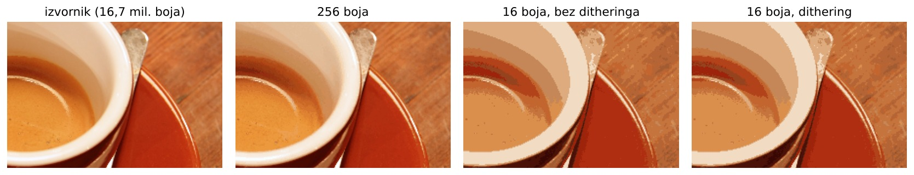{width=100%}

::::::: {.columns align=top}
:::: {.column width="62%"}
- Najviše **256 boja** iz vlastite palete zapisane u datoteci
- Stepeničasti prijelazi ublažavaju se **ditheringom**: miješanjem raspoloživih boja u sitan uzorak
- Podržava prozirnost (jedna boja palete) i jednostavnu animaciju
::::
:::: {.column width="36%"}
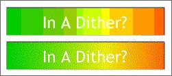{width=100%}
::::
:::::::

## PNG --- filtriranje prije sažimanja

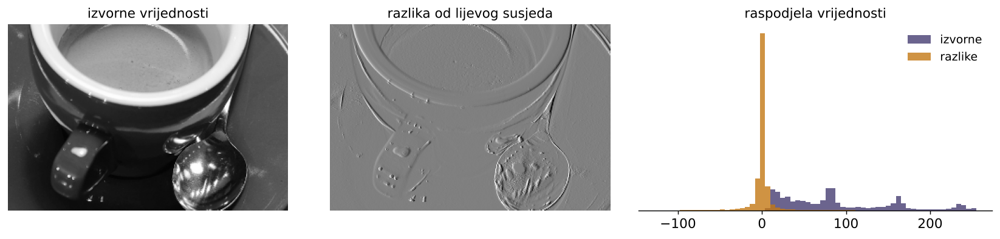{width=100%}

- Prije sažimanja svaki se redak preoblikuje: umjesto vrijednosti zapisuje se **razlika** u odnosu na susjeda
- Pet filtara: `None`, `Sub`, `Up`, `Average`, `Paeth`; bira se za svaki redak posebno
- Razlike su gusto nagomilane oko nule --- takav niz DEFLATE sažima znatno bolje

## TIFF --- fleksibilan spremnik

- *Tagged Image File Format* (1986.) --- nije jedan format nego **okvir** u koji stane mnogo različitih zapisa
- Sve je opisano **tagovima**: svaki podatak ima oznaku, tip i vrijednost
- Jedna datoteka može sadržavati **više slika**, slojeve, 16 bita po kanalu, CMYK, ICC profil
- Podaci o pikselima dijele se u **trake** (*strips*) ili **pločice** (*tiles*) koje se obrađuju neovisno --- veliku sliku nije nužno učitati cijelu
- Profesionalna primjena: tisak, arhiva, kartografija, medicinska i tehnička fotografija

\vspace{0.5ex}

\begin{deklaracija}
Ista struktura tagova temelj je i EXIF metapodataka u JPEG datotekama.
\end{deklaracija}

## TIFF --- struktura

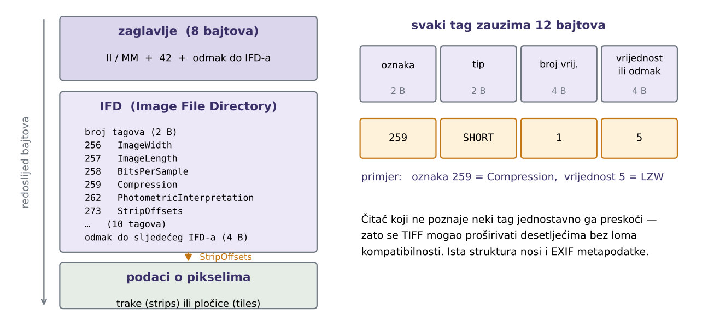{width=100%}

## TIFF --- izbor sažimanja

- Tag `Compression` određuje postupak; čitač ga mora podržavati:

```{=latex}
\begin{center}\small
\begin{tabular}{@{}rl@{\hspace{4em}}rl@{}}
\texttt{1} & bez sažimanja            & \texttt{32773} & PackBits (RLE)\\[0.3ex]
\texttt{5} & LZW (bez gubitka)        & \texttt{3}, \texttt{4} & CCITT (faksimil, 1 bit)\\[0.3ex]
\texttt{8} & ZIP / DEFLATE (bez gubitka) & \texttt{7} & JPEG (\textbf{s gubitkom})\\
\end{tabular}
\end{center}
```

- Zato *TIFF* sam po sebi ne jamči da je slika neizmijenjena --- treba pogledati koji je postupak upotrijebljen
- Fleksibilnost ima cijenu: nije rijetko da neki čitač ne podržava baš svaku kombinaciju tagova

\begin{deklaracija}
Za arhivu se u pravilu bira bez sažimanja ili ZIP; JPEG unutar TIFF-a poništava razlog zbog kojeg se TIFF uopće odabire.
\end{deklaracija}

## Kada LZW pomaže, a kada odmaže

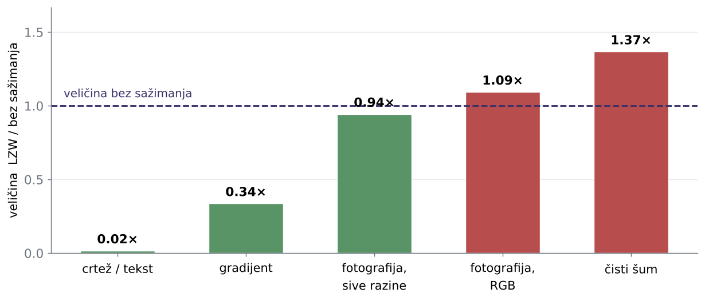{width=74%}

- LZW gradi **rječnik ponovljenih nizova**; kod koji ih zamjenjuje ima 9 do 12 bita
- Nema li ponavljanja, 8-bitni bajt postaje 9-bitni kod --- datoteka **naraste**
- U fotografiji u boji trojke (R,G,B) rijetko se ponavljaju doslovno

## Usporedba na istoj slici

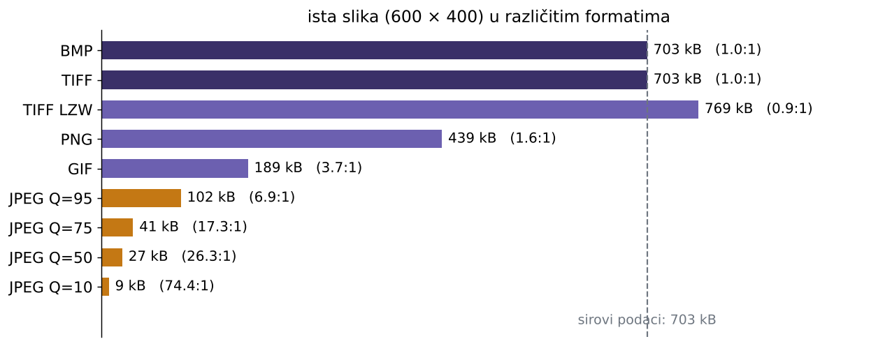{height=78%}

# Sažimanje s gubitkom

## JPEG

- **JPEG** (*Joint Photographic Experts Group*, 1992.) --- najčešći format za fotografije
- Polazište: oko je osjetljivije na **svjetlinu** nego na boju, i slabo opaža **fine promjene**
- Postupak u šest koraka:
    1. pretvorba RGB → YCbCr (svjetlina + dvije kromatske komponente)
    2. poduzorkovanje kromatskih kanala
    3. podjela na blokove $8 \times 8$ piksela
    4. prijelaz u frekvencijsku domenu (DCT)
    5. **kvantizacija** --- ovdje se gubi informacija
    6. zig-zag poredak, RLE i Huffmanovo kodiranje

## Koraci JPEG sažimanja

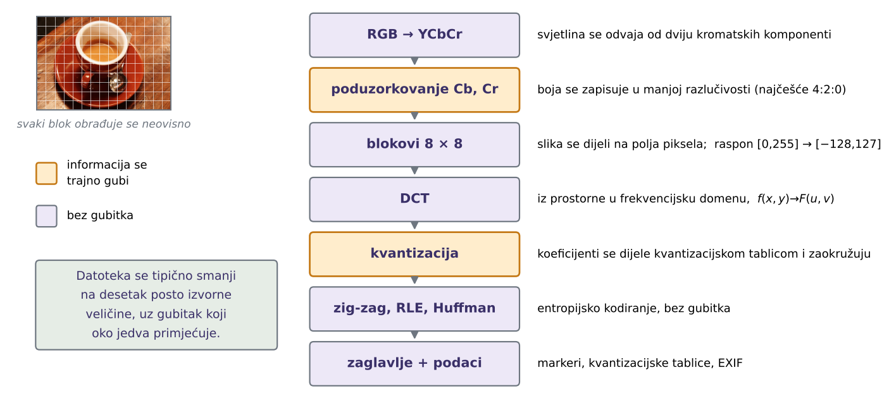{width=100%}

## Poduzorkovanje kroma

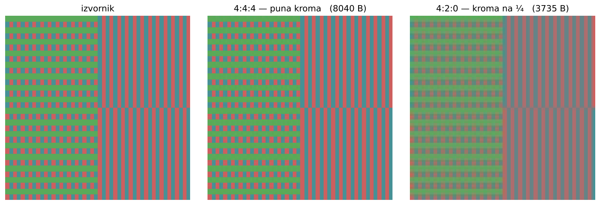{width=88%}

- **4:4:4** --- puna kromatska rezolucija; **4:2:0** --- kroma na četvrtini broja uzoraka
- Svjetlina ostaje netaknuta, pa je gubitak na fotografiji teško primijetiti

## Poduzorkovanje kroma

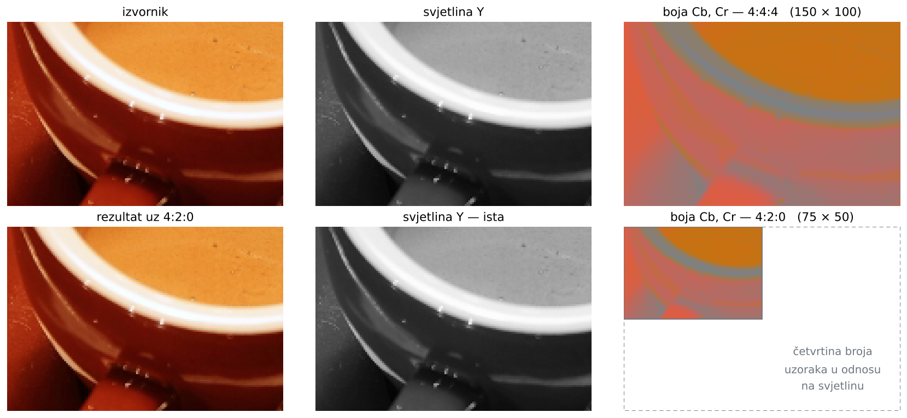{height=78%}

## Kvantizacija i stupanj kvalitete

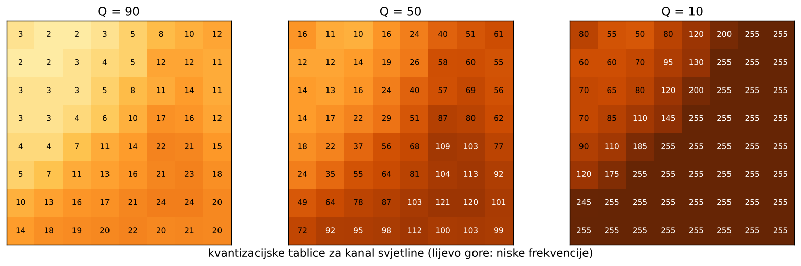{width=86%}

- Svaki se DCT koeficijent dijeli odgovarajućim brojem iz tablice i zaokružuje
- Veći brojevi (više frekvencije, dolje desno) --- više koeficijenata postaje nula

## Što se vidi pri jakom sažimanju

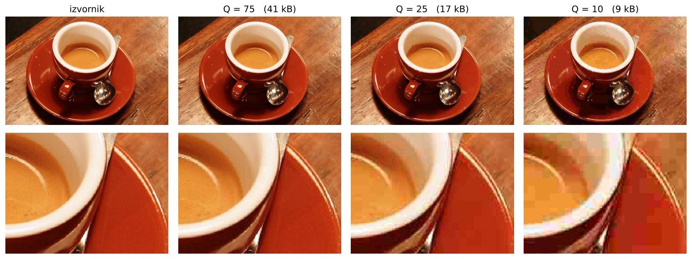{width=100%}

## Artefakti JPEG sažimanja

:::::: columns
::: {.column width="52%"}
- **Blokovi** $8 \times 8$ --- vidljiva mreža na glatkim prijelazima
- **Ringing** --- svijetli i tamni obrubi uz oštre rubove
- **Razlijevanje boje** --- posljedica poduzorkovanja kroma
- Artefakti su **trag obrade**, a ne svojstvo scene
:::
::: {.column width="46%"}
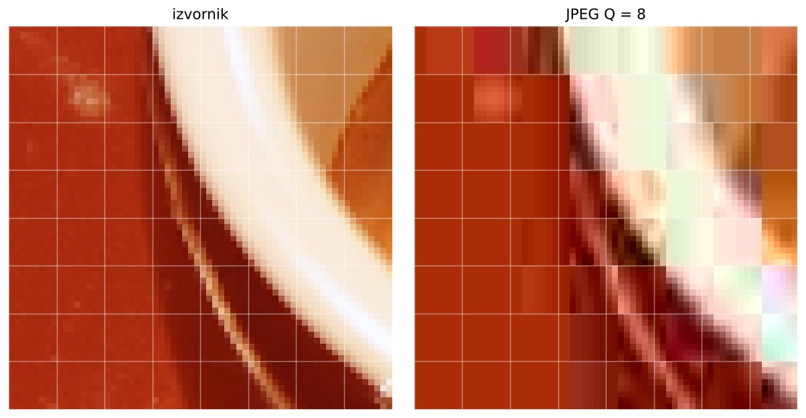{width=100%}
:::
::::::

# Spremnik i metapodaci

## JPEG, JFIF i EXIF

- **JPEG** --- definira **način sažimanja** podataka
    - dopušta različite prostore boja i različit stupanj sažimanja po kanalu
    - ne propisuje kako se u datoteku zapisuje sve što je potrebno za obnavljanje slike
- **JFIF** (*JPEG File Interchange Format*) --- definira **sve detalje za pohranu i prijenos** slike koje JPEG nije specificirao: prostor boja (YCbCr), gustoću piksela, raspored podataka
- **EXIF** (*Exchangeable Image File Format*) --- noviji, **nije kompatibilan** s JFIF-om
    - metapodaci u tagovima, po uzoru na TIFF; proizvođač smije dodati vlastite (postavke kamere, geolokacija)

\vspace{1ex}

\begin{deklaracija}
„JPEG datoteka“ u praksi znači: JPEG sažimanje, upakirano po JFIF ili EXIF pravilima.
\end{deklaracija}

## Struktura JPEG datoteke

Podaci su podijeljeni u segmente, svaki počinje oznakom `FF`:

```
      0  FFD8  SOI   početak slike
      2  FFE0  APP0  JFIF zaglavlje              16 B
     20  FFDB  DQT   kvantizacijska tablica      67 B
     89  FFDB  DQT   kvantizacijska tablica      67 B
    158  FFC0  SOF0  parametri slike             17 B
    177  FFC4  DHT   Huffmanova tablica          31 B
    ...
    609  FFDA  SOS   početak sažetih podataka    12 B
 72 324  FFD9  EOI   kraj slike
```

- `SOF0` je osnovni, a `SOF2` progresivni JPEG
- **Kvantizacijske tablice su u datoteci** --- i razlikuju se među uređajima i programima

## EXIF --- što sve zapisuje

```
Make              NIKON CORPORATION
Model             NIKON D750
Software          Adobe Photoshop 25.0 (Windows)
DateTime          2026:06:14 19:02:17
DateTimeOriginal  2026:06:14 18:23:41
ExposureTime      1/250        FNumber        5.6
ISOSpeedRatings   400          FocalLength    85 mm
LensModel         AF-S NIKKOR 85mm f/1.8G
GPSLatitude       43° 30' 50.83" N
GPSLongitude      16° 26' 31.22" E
```

- Uz to: orijentacija, balans bijele, bljeskalica, serijski broj uređaja, **ugrađena sličica** (*thumbnail*)

## Što EXIF odaje

- `Software` imenuje program kojim je datoteka spremljena
- `DateTime` ≠ `DateTimeOriginal`: prvo je vrijeme zadnjeg spremanja, drugo vrijeme snimanja
- GPS koordinate i serijski broj uređaja vežu sliku uz mjesto i opremu

\vspace{1ex}

\begin{deklaracija}
Metapodaci se lako mijenjaju i brišu, pa njihova vjerodostojnost nije veća od vjerodostojnosti same slike. Njihovo \textbf{odsustvo} također je podatak.
\end{deklaracija}

## Ugrađena sličica (*thumbnail*)

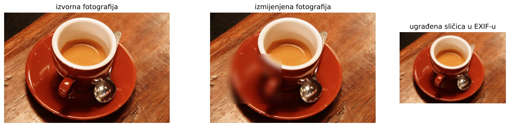{width=100%}

- Sličica se zapisuje pri snimanju; mnogi programi je pri izmjeni slike **ne osvježe**
- Neslaganje sličice i slike izravan je trag izmjene

# Moderni formati

## HEIF, AVIF, WebP, JPEG XL

- **HEIF/HEIC** --- spremnik iz obitelji MP4, slika sažeta kodekom HEVC
    - zadani format na iPhoneu; 10 bita po kanalu, više slika u datoteci, karta dubine
- **AVIF** --- isti pristup, kodek AV1; sve češći na webu
- **WebP** --- Google, sažimanje sa i bez gubitka u istom formatu
- **JPEG XL** --- noviji standard, može sažeti postojeći JPEG bez ponovnog gubitka

## Zašto su forenzički zahtjevniji

- Klasične metode razvijene su za JPEG: blokovi $8 \times 8$, kvantizacijske tablice, tragovi dvostrukog sažimanja
- Moderni kodeci koriste blokove promjenjive veličine i predviđanje unutar slike
- Alati su manje zreli, a dokumentacija spremnika složenija
- U praksi se slika često **pretvara u JPEG** pri dijeljenju --- forenzičar tada analizira pretvorbu, a ne izvorni zapis

# Zaključak

## Što format otkriva

- **Potpis i struktura datoteke** --- je li datoteka ono što tvrdi da jest
- **Kvantizacijske tablice** --- potpis uređaja ili programa koji je sliku spremio
- **Redoslijed segmenata i tagova** --- različiti programi i uređaji pišu različito
- **Metapodaci** --- uređaj, vrijeme, mjesto, tragovi obrade
- **Ugrađena sličica** (*thumbnail*) --- može sadržavati raniju verziju slike

\vspace{1ex}

\begin{deklaracija}
Prije nego što analiziramo sadržaj slike, analiziramo datoteku koja ju nosi.
\end{deklaracija}
