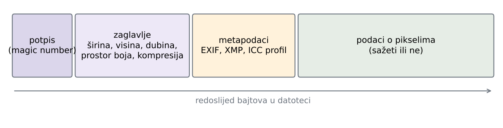
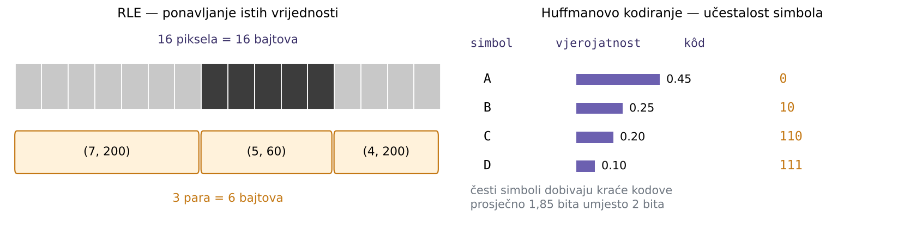

# Podsjetnik

## Od scene do datoteke

- Prošla predavanja: kako svjetlost postaje matrica brojeva
    - senzor → CFA → demozaikiranje → balans bijele → gama → **zapis u datoteku**
- Slika u memoriji je matrica $f(m, n)$:
    - **dimenzije** --- broj redaka i stupaca
    - **dubina** --- broj bita po komponenti (najčešće 8)
    - **prostor boja** --- RGB, sive razine, CMYK

\vspace{1ex}

\begin{deklaracija}
Datoteka mora sadržavati sve to --- i same vrijednosti piksela, i podatke bez kojih se te vrijednosti ne mogu protumačiti.
\end{deklaracija}

## Koliko je to podataka?

- Slika $600 \times 400$ u boji, 8 bita po komponenti:

$$600 \times 400 \times 3 = 720\,000 \text{ bajtova} \approx 703 \text{ kB}$$

- Fotografija iz 24 Mpx aparata: $6000 \times 4000 \times 3 \approx 69$ MB
- Isti aparat u 14-bitnom RAW zapisu: $6000 \times 4000 \times 14$ bita $\approx 40$ MB

\vspace{1ex}

- Memorijska kartica od 64 GB primila bi oko 900 takvih nekomprimiranih fotografija
- **Sažimanje nije luksuz nego nužnost**

# Slikovna datoteka

## Što datoteka sadrži

{width=100%}

- Raspored i naziv dijelova ovise o formatu, ali sadržaj je uvijek sličan
- Bez zaglavlja niz bajtova nema značenje: isti podaci mogu biti slika $600 \times 400$ ili $400 \times 600$

## Potpis datoteke

Prvih nekoliko bajtova identificira format (*magic number*):

```
BMP    42 4D                          BM
PNG    89 50 4E 47 0D 0A 1A 0A        .PNG....
JPEG   FF D8 FF E0 ... 4A 46 49 46    ......JFIF
GIF    47 49 46 38 37 61              GIF87a
TIFF   49 49 2A 00                    II*.        (little-endian)
       4D 4D 00 2A                    MM.*        (big-endian)
WebP   52 49 46 46 .... 57 45 42 50   RIFF....WEBP
```

- Ekstenzija je samo dio imena --- **format se prepoznaje po sadržaju**
- Preimenovanje `slika.png` u `slika.jpg` ne mijenja ništa u datoteci

## Zašto je to forenzički važno

- Ekstenzija koja ne odgovara sadržaju --- trag da je datoteka preimenovana ili prerađena
- Sadržaj skriven pod krivom ekstenzijom
- Podaci nadodani **iza** kraja slike (slika se prikazuje normalno)

\vspace{1ex}

\begin{deklaracija}
Prvo pitanje u analizi datoteke nije „što se vidi na slici“, nego „je li ovo doista datoteka onog formata koji ime obećava“.
\end{deklaracija}

## Redoslijed bajtova

- Vrijednosti veće od jednog bajta mogu se zapisati na dva načina:
    - **little-endian** --- najmanje značajan bajt prvi (Intel)
    - **big-endian** --- najznačajniji bajt prvi (Motorola, mrežni poredak)
- Broj $90 = 0\text{x}0000005A$ zapisuje se kao:

```
little-endian:   5A 00 00 00
big-endian:      00 00 00 5A
```

- TIFF (a time i EXIF) podržava **oba**, pa prva dva bajta kazuju koji je u uporabi
- Pogrešna pretpostavka o poretku daje besmislene vrijednosti pri čitanju

# Podjela formata

## Tri skupine

{width=94%}

# Formati bez sažimanja

## BMP --- mapa bitova

- Vrijednosti piksela zapisuju se u izvornom obliku, bez ikakve obrade
- Struktura: `BITMAPFILEHEADER` (14 B) + `BITMAPINFOHEADER` (40 B) + polje piksela
- Tri osobine koje iznenade pri prvom čitanju:
    - komponente se zapisuju redom **B, G, R**
    - retci idu **odozdo prema gore**
    - svaki redak dopunjava se nulama do višekratnika **4 bajta**

\vspace{1ex}

\begin{deklaracija}
Veličina datoteke: $54 + \text{visina} \times \lceil 3 \cdot \text{širina} / 4 \rceil \cdot 4$ bajtova.
\end{deklaracija}

## BMP --- primjer

Slika $3 \times 2$ piksela, datoteka ima **78 bajtova**:

```
0000  42 4D 4E 00 00 00 00 00 00 00 36 00    zaglavlje
000C  00 00 28 00 00 00 03 00 00 00 02 00    zaglavlje
0018  00 00 01 00 18 00 00 00 00 00 18 00    zaglavlje
0024  00 00 C4 0E 00 00 C4 0E 00 00 00 00    zaglavlje
0030  00 00 00 00 00 00 00 FF 00 00 00 00    pikseli
003C  00 FF FF 00 00 00 00 00 FF FF FF FF    pikseli
0048  FF 00 00 00 00 00                      pikseli
```

- `42 4D` = `BM`; `4E 00 00 00` = 78 (veličina); `36 00 00 00` = 54 (odmak do piksela)
- `03 00 00 00` = širina 3, `02 00 00 00` = visina 2, `18 00` = 24 bita po pikselu

## BMP --- čitanje piksela

Redak zauzima $3 \times 3 = 9$ B podataka, dopunjeno do 12 B:

```
redak zapisan prvi:  00 FF 00 | 00 00 00 | 00 FF FF | 00 00 00
                       zelena     crna      žuta      dopuna

redak zapisan drugi: 00 00 FF | FF FF FF | FF 00 00 | 00 00 00
                      crvena    bijela     plava      dopuna
```

- Prvi zapisani redak je **donji** redak slike
- `00 00 FF` je crvena, a ne plava --- poredak je B, G, R

## Prednosti i nedostaci

:::::: columns
::: {.column width="49%"}
**Prednosti**

- Krajnje jednostavan zapis, izravno prati matricu piksela
- Čitanje i pisanje bez biblioteka
- Nema gubitka informacije
:::
::: {.column width="49%"}
**Nedostaci**

- Velike datoteke, spor prijenos
- Ograničen na RGB
- Ne podržava prozirnost ni metapodatke
:::
::::::

\vspace{1ex}

- Srodni formati: **PPM/PGM/PBM** --- još jednostavniji, s tekstualnim zaglavljem
- U praksi se koriste za crteže i međurezultate obrade, rijetko za fotografije

# Osnove sažimanja

## Tri vrste redundancije

- **Prostorna** --- susjedni pikseli su slični; vrijednost se može predvidjeti iz okoline
- **Kodna** --- sve vrijednosti nisu jednako česte; čestima se može dati kraći kôd
- **Psihovizualna** --- dio informacije oko slabo opaža, pa se može odbaciti

\vspace{1ex}

\begin{deklaracija}
Sažimanje \textbf{bez gubitka} uklanja samo prvu i drugu vrstu. Sažimanje \textbf{s gubitkom} dira i treću --- i zato je nepovratno.
\end{deklaracija}

## RLE i Huffman

{width=100%}

## Koliko se može sažeti?

- **Omjer sažimanja:** veličina izvornih podataka naspram veličine datoteke
- Teorijska granica sažimanja bez gubitka je **entropija** izvora
- Nijedan algoritam ne može sažeti sve ulaze --- ako neke skraćuje, druge nužno produljuje

\vspace{1ex}

\begin{deklaracija}
Fotografija je šumovita i gotovo nikad nema dugih nizova jednakih piksela, pa na njoj RLE i slični postupci slabo pomažu --- ponekad datoteku i povećaju.
\end{deklaracija}

# Sažimanje bez gubitka

## Rječnički postupci

- **LZW** (*Lempel-Ziv-Welch*) --- gradi rječnik nizova koji se ponavljaju
    - koristi ga GIF, a kao opcija i TIFF
    - do 2004. bio zaštićen patentom, što je potaknulo razvoj PNG-a
- **DEFLATE** --- kombinacija LZ77 (traženje ponavljanja) i Huffmanova kodiranja
    - koristi ga PNG, kao i `zip` i `gzip`
- Oba su **opći** postupci nad nizom bajtova; ne znaju ništa o slici

## PNG --- filtriranje prije sažimanja

{width=100%}

- Prije sažimanja svaki se redak preoblikuje: umjesto vrijednosti zapisuje se **razlika** u odnosu na susjeda
- Pet filtara: `None`, `Sub`, `Up`, `Average`, `Paeth`; bira se za svaki redak posebno
- Razlike su gusto nagomilane oko nule --- takav niz DEFLATE sažima znatno bolje

## GIF --- ograničena paleta

{width=100%}

- Najviše **256 boja** iz vlastite palete zapisane u datoteci
- Na fotografijama nastaju stepeničasti prijelazi; ublažavaju se **ditheringom**
- Podržava prozirnost (jedna boja palete) i jednostavnu animaciju

## TIFF --- fleksibilan spremnik

- Zapis u obliku **tagova**: svaki podatak ima oznaku, tip i vrijednost
- Podržava zapis bez sažimanja i sažimanje bez gubitka (LZW, ZIP), ali i JPEG
- Podaci se dijele u **trake** (*strips*) ili **pločice** (*tiles*) koje se sažimaju neovisno
- Može sadržavati više slika u jednoj datoteci, slojeve, CMYK, 16 bita po kanalu
- Profesionalna primjena: tisak, arhiva, tehnička fotografija

\vspace{1ex}

\begin{deklaracija}
Ista struktura tagova temelj je i EXIF metapodataka u JPEG datotekama.
\end{deklaracija}

## Usporedba na istoj slici

{height=78%}

# Sažimanje s gubitkom

## JPEG --- osnovna ideja

- **JPEG** (*Joint Photographic Experts Group*, 1992.) --- najčešći format za fotografije
- Polazište: oko je osjetljivije na **svjetlinu** nego na boju, i slabo opaža **fine promjene**
- Postupak u šest koraka:
    1. pretvorba RGB → YCbCr (svjetlina + dvije kromatske komponente)
    2. poduzorkovanje kromatskih kanala
    3. podjela na blokove $8 \times 8$ piksela
    4. prijelaz u frekvencijsku domenu (DCT)
    5. **kvantizacija** --- ovdje se gubi informacija
    6. zig-zag poredak, RLE i Huffmanovo kodiranje

## Poduzorkovanje kroma

{width=88%}

- **4:4:4** --- puna kromatska rezolucija; **4:2:0** --- kroma na četvrtini broja uzoraka
- Svjetlina ostaje netaknuta, pa je gubitak na fotografiji teško primijetiti

## Kvantizacija i stupanj kvalitete

{width=86%}

- Svaki se DCT koeficijent dijeli odgovarajućim brojem iz tablice i zaokružuje
- Veći brojevi (više frekvencije, dolje desno) --- više koeficijenata postaje nula

## Što se vidi pri jakom sažimanju

{width=100%}

## Artefakti JPEG sažimanja

:::::: columns
::: {.column width="52%"}
- **Blokovi** $8 \times 8$ --- vidljiva mreža na glatkim prijelazima
- **Ringing** --- svijetli i tamni obrubi uz oštre rubove
- **Razlijevanje boje** --- posljedica poduzorkovanja kroma
- Artefakti su **trag obrade**, a ne svojstvo scene
:::
::: {.column width="46%"}
{width=100%}
:::
::::::

# RAW

## Što je RAW

- **Izravno očitanje senzora**, bez obrade i bez sažimanja s gubitkom
- Još uvijek **CFA mozaik** --- jedna vrijednost po pikselu, ne tri
- Dubina 12--16 bita po pikselu, linearni odziv
- Uz podatke senzora zapisuju se postavke snimanja i puni metapodaci
- Datoteka nije spremna za prikaz --- fotografiju treba **razviti**

\vspace{1ex}

\begin{deklaracija}
Često se naziva \textbf{digitalnim negativom}, po analogiji s klasičnom fotografijom.
\end{deklaracija}

## Razvijanje

{width=100%}

- Odluke koje kamera inače donosi same prelaze na računalo: balans bijele, ekspozicija, kontrast, zasićenje, izoštravanje, uklanjanje šuma
- Isti RAW može dati vrlo različite fotografije --- bez ikakve izmjene izvornih podataka

## Formati i ograničenja

- Format ovisi o proizvođaču i često o modelu:
    - **CR2, CR3** (Canon), **NEF** (Nikon), **ARW** (Sony), **RAF** (Fuji), **ORF** (Olympus)
- **DNG** (Adobe) --- pokušaj otvorenog standarda
- Datoteke su velike, a podrška starijih programa neujednačena

\vspace{1ex}

\begin{deklaracija}
RAW je najbliži onome što je senzor zabilježio, ali ni on sam po sebi ne dokazuje autentičnost: i RAW datoteka može se izmijeniti ili generirati.
\end{deklaracija}

# Spremnik i metapodaci

## JPEG, JFIF i EXIF

- **JPEG** --- način sažimanja podataka
    - ne propisuje kako se slika zapisuje u datoteku
- **JFIF** (*JPEG File Interchange Format*) --- dogovara sve što JPEG nije: gustoću piksela, prostor boja, raspored podataka
- **EXIF** (*Exchangeable Image File Format*) --- metapodaci o snimanju, zapisani u TIFF strukturi tagova

\vspace{1ex}

\begin{deklaracija}
„JPEG datoteka“ u praksi znači: JPEG sažimanje, upakirano po JFIF ili EXIF pravilima.
\end{deklaracija}

## Struktura JPEG datoteke

Podaci su podijeljeni u segmente, svaki počinje oznakom `FF`:

```
      0  FFD8  SOI   početak slike
      2  FFE0  APP0  JFIF zaglavlje              16 B
     20  FFDB  DQT   kvantizacijska tablica      67 B
     89  FFDB  DQT   kvantizacijska tablica      67 B
    158  FFC0  SOF0  parametri slike             17 B
    177  FFC4  DHT   Huffmanova tablica          31 B
    ...
    609  FFDA  SOS   početak sažetih podataka    12 B
 72 324  FFD9  EOI   kraj slike
```

- `SOF0` je osnovni, a `SOF2` progresivni JPEG
- **Kvantizacijske tablice su u datoteci** --- i razlikuju se među uređajima i programima

## EXIF --- što sve zapisuje

```
Make              NIKON CORPORATION
Model             NIKON D750
Software          Adobe Photoshop 25.0 (Windows)
DateTime          2026:06:14 19:02:17
DateTimeOriginal  2026:06:14 18:23:41
ExposureTime      1/250        FNumber        5.6
ISOSpeedRatings   400          FocalLength    85 mm
LensModel         AF-S NIKKOR 85mm f/1.8G
GPSLatitude       43° 30' 50.83" N
GPSLongitude      16° 26' 31.22" E
```

- Uz to: orijentacija, balans bijele, bljeskalica, serijski broj uređaja, **ugrađena sličica**

## Što EXIF odaje

- `Software` imenuje program kojim je datoteka spremljena
- `DateTime` ≠ `DateTimeOriginal`: prvo je vrijeme zadnjeg spremanja, drugo vrijeme snimanja
- GPS koordinate i serijski broj uređaja vežu sliku uz mjesto i opremu

\vspace{1ex}

\begin{deklaracija}
Metapodaci se lako mijenjaju i brišu, pa njihova vjerodostojnost nije veća od vjerodostojnosti same slike. Njihovo \textbf{odsustvo} također je podatak.
\end{deklaracija}

## Ugrađena sličica

{width=100%}

- Sličica se zapisuje pri snimanju; mnogi programi je pri izmjeni slike **ne osvježe**
- Neslaganje sličice i slike izravan je trag izmjene

# Moderni formati

## HEIF, AVIF, WebP, JPEG XL

- **HEIF/HEIC** --- spremnik iz obitelji MP4, slika sažeta kodekom HEVC
    - zadani format na iPhoneu; 10 bita po kanalu, više slika u datoteci, karta dubine
- **AVIF** --- isti pristup, kodek AV1; sve češći na webu
- **WebP** --- Google, sažimanje sa i bez gubitka u istom formatu
- **JPEG XL** --- noviji standard, može sažeti postojeći JPEG bez ponovnog gubitka

## Zašto su forenzički zahtjevniji

- Klasične metode razvijene su za JPEG: blokovi $8 \times 8$, kvantizacijske tablice, tragovi dvostrukog sažimanja
- Moderni kodeci koriste blokove promjenjive veličine i predviđanje unutar slike
- Alati su manje zreli, a dokumentacija spremnika složenija
- U praksi se slika često **pretvara u JPEG** pri dijeljenju --- forenzičar tada analizira pretvorbu, a ne izvorni zapis

# Zaključak

## Što format otkriva

- **Potpis i struktura datoteke** --- je li datoteka ono što tvrdi da jest
- **Kvantizacijske tablice** --- potpis uređaja ili programa koji je sliku spremio
- **Redoslijed segmenata i tagova** --- različiti programi pišu različito
- **Metapodaci** --- uređaj, vrijeme, mjesto, tragovi obrade
- **Ugrađena sličica** --- može sadržavati raniju verziju slike

\vspace{1ex}

\begin{deklaracija}
Prije nego što analiziramo sadržaj slike, analiziramo datoteku koja ju nosi.
\end{deklaracija}
